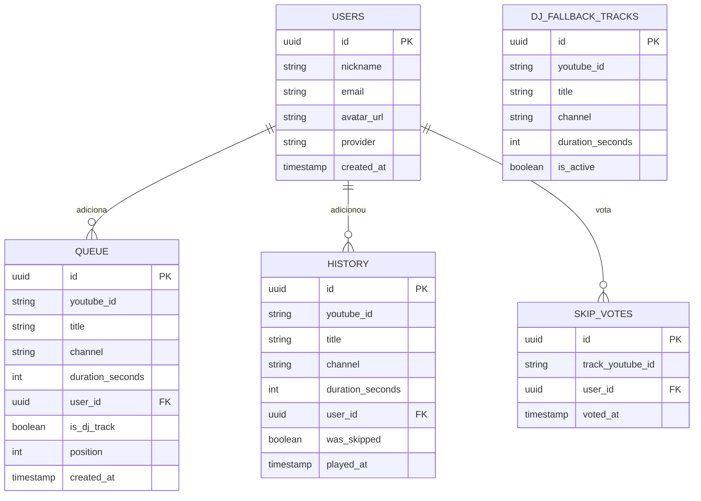

# Especificação do Projeto (SPEC.md) - Rádio 2.0

Este documento define os requisitos funcionais, histórias de usuário, regras de negócio estritas e garantias de performance da **Rádio 2.0**.

---

## 1. Princípios da Rádio (Comportamento Central)

1. **A rádio não para (Sem Play/Pause tradicional)**:
   - A transmissão é síncrona e contínua para todos os ouvintes conectados.
   - A interface **não exibe botões de pausa ou play individual**.
   - O ouvinte possui controle local de **Mute/Desmutar** e **Volume**.
   - Modo "Caixa de Som da Sala": desativa o áudio no cliente atual para permitir que ele funcione apenas como controle remoto da rádio sem eco na sala.
2. **Sincronização Contínua Forçada (Anti-Drift)**:
   - Ao carregar a aplicação, o player calcula o deslocamento temporal (`serverTime - trackStartedAt`) e executa imediatamente `seekTo(segundos, true)`.
   - Se o navegador travar ou se o usuário tentar pausar o vídeo por atalhos ou extensões, a aplicação detecta o desvio e força o avanço imediato para o tempo ao vivo do servidor.
3. **Fatiamento de Dados (Memória e Escalabilidade)**:
   - **Fila Fatiada**: O servidor transmite para o cliente apenas o próximo bloco de reprodução (ex: as próximas 5 faixas imediatas) acompanhado do contador total de faixas aguardando e duração estimada.
   - **Histórico Fatiado**: O histórico é paginado e carregado sob demanda (blocos de 10 faixas), poupando memória em dispositivos móveis.
4. **Design 100% Responsivo e Mobile-First**:
   - Experiência otimizada para smartphones (uso da rádio em trânsito com uma mão), tablets e desktops / TVs ("modo caixa de som da sala").
   - Transição fluida entre abas/gavetas no mobile e painéis em multi-colunas no desktop.
5. **Desenvolvimento Orientado a Testes (TDD)**:
   - Ciclo obrigatório TDD: especificação do teste antes do código, implementação para passar no teste e refatoração contínua.
6. **Isolamento de Infraestrutura**:
   - Todo dado e requisição externa (busca no YouTube, autenticação, banco) é intermediado pelo **Backend em Go**. O Frontend nunca se conecta diretamente ao PostgreSQL ou à API do YouTube.

---

## 2. Design System & Identidade Visual (Figma Specs)

Baseado nos protótipos de alta fidelidade do projeto ([`dark-theme.jpg`](file:///home/paschoal/Documentos/Aulas-igu/Radio%202.0/dark-theme.jpg) e [`light-theme.jpg`](file:///home/paschoal/Documentos/Aulas-igu/Radio%202.0/light-theme.jpg)):

### 2.1 Tipografia
* **Fonte Principal (UI / Textos / Títulos):** `Inter` ou `Roboto` (sem serifa, neutra e de alta legibilidade).
* **Fonte para Títulos e Display:** `Poppins` ou `Montserrat` (cabeçalhos, nomes de salas e logo).
* **Escala Tipográfica:**
  - `H1 / Logo`: 24px – Bold (700)
  - `H2 / Títulos de Seção`: 18px a 20px – SemiBold (600)
  - `H3 / Nome de Faixa / Sala`: 14px a 16px – SemiBold (600)
  - `Body / Textos Gerais`: 14px – Regular (400)
  - `Captions / Metadados (ouvintes, tempo)`: 11px a 12px – Regular (400) ou Medium (500)

### 2.2 Paleta de Cores – Modo Dark (Azul, Preto e Vermelho)
* `--bg-base`: `#0B0F19` (Fundo principal: preto com nuance azulada profunda)
* `--bg-surface`: `#111827` (Cards e painéis: azul-marinho grafite escuro)
* `--bg-surface-elevated`: `#1F2937` (Superfícies elevadas / hover / inputs e chips)
* `--primary-accent`: `#EF4444` / `#DC2626` (Destaque primário: vermelho vibrante para "AO VIVO", "Entrar", "Sair")
* `--border-subtle`: `#1E293B` (Bordas / divisórias de baixo contraste)
* `--text-primary`: `#F9FAFB` (Branco gelo)
* `--text-muted`: `#94A3B8` (Cinza azulado claro para metadados)

### 2.3 Paleta de Cores – Modo Light (Cinza, Preto e Vermelho)
* `--bg-base`: `#F3F4F6` (Fundo principal: cinza claro neutro)
* `--bg-surface`: `#FFFFFF` (Cards e painéis: branco puro)
* `--bg-surface-muted`: `#E5E7EB` (Superfícies secundárias / inputs / chips)
* `--primary-accent`: `#EF4444` / `#E11D48` (Destaque primário: vermelho vibrante)
* `--border-subtle`: `#E2E8F0` (Bordas e divisórias suaves)
* `--text-primary`: `#111827` (Preto grafite de alta legibilidade)
* `--text-muted`: `#64748B` (Cinza médio para metadados e status)

---

## 3. Arquitetura de Telas & Adaptações Mobile

### 3.1 Layout Desktop (> 1024px) - 3 Colunas + Sticky Footer
1. **Header Superior:** Logo `RÁDIO` com ondas concêntricas vermelhas, barra central de busca `Buscar músicas, artistas, rádios...`, ícone de notificação, avatar e botão vermelho `[ Sair ]` / `[ Entrar ]`.
2. **Coluna Esquerda:** Menu de navegação lateral (`Início`, `Explorar`, `Salas`).
3. **Painel Central Superior:** Histórico de busca recente com chips e carrossel de estações/faixas ouvidas anteriormente.
4. **Painel Central Inferior:** 
   - Grid de **Salas de Rádio** (`Pop Hits 24h`, `Rock Clássico`, `Festa & Balada`), cada uma com thumbnail, contador de ouvintes ativos com avatares, badge vermelha `AO VIVO` e botão vermelho `[ Entrar ]`.
   - Painel de **Chatativo** (Chat ao vivo com mensagens, avatares e envio em tempo real).
5. **Coluna Direita:** **Fila de Reprodução** com lista numerada (`1`, `2`, `3`...), thumbnails, título, artista e contagem de curtidas/votos.
6. **Sticky Footer Player (Fixo no Rodapé):** Controles, foto do locutor/capa, nome da faixa/estação, equalizador de onda sonora animado em vermelho, botão de mute, slider de volume e barra de progresso sincronizada ao vivo.

### 3.2 Adaptações para Mobile (< 768px)
* **Visualização Unificada com Bottom Navigation:**
  - Em telas menores que 768px, as 3 colunas são transformadas em telas alternáveis via barra de navegação inferior com 4 abas:
    1. 📻 **Salas / No Ar:** Visualização das salas ativas e da sala conectada.
    2. 📜 **Fila:** Fila de reprodução numerada em tela cheia com botão flutuante para adicionar música.
    3. 💬 **Chat:** Chatativo em tempo real otimizado para teclado virtual.
    4. 🔍 **Buscar:** Campo de busca do YouTube e histórico com chips de toque rápido.
* **Mini-Player Sticky Inferior:**
  - Fixado logo acima da barra de navegação inferior.
  - Exibe thumbnail, título, botão de mute rápido e barra fina de progresso ao vivo.
  - Ao tocar, expande em um *Bottom Sheet* com onda sonora completa e controles de volume.
* **Área de Toque Amigável:** Todos os botões, chips e itens de lista possuem altura mínima de `44px` para uso confortável com uma mão.

---

## 4. Histórias de Usuário

### Como Ouvinte:
* **HU01 - Entrada na Rádio:** Quero entrar na rádio rapidamente informando meu apelido (convidado com avatar) ou via conta Google, para que meus pedidos e votos fiquem identificados.
* **HU02 - Ouvir Sincronizado:** Quero abrir a página e imediatamente ouvir a música que está no ar no mesmo ponto que todos os outros ouvintes.
* **HU03 - Controle de Áudio:** Quero poder mutar e ajustar o volume do meu player sem interromper a transmissão para os outros.
* **HU04 - Modo Caixa da Sala:** Quero silenciar o som no meu dispositivo móvel para usá-lo apenas para pedir músicas e votar, enquanto uma caixa de som principal toca na sala.
* **HU05 - Buscar e Pedir Música:** Quero buscar músicas por nome ou colar link e adicionar à fila, respeitando o limite máximo permitido por pessoa.
* **HU06 - Acompanhar a Fila:** Quero ver as próximas músicas que vão tocar, quem pediu e quanto tempo falta.
* **HU07 - Votar para Pular:** Quero votar para pular a música atual se eu não gostar dela, sabendo quantos votos faltam para ela ser pulada.
* **HU08 - Consultar Histórico:** Quero ver a lista das músicas que tocaram recentemente com o horário e quem as pediu.

### Como Sistema / DJ Automático:
* **HU09 - Manutenção da Transmissão:** Quando a fila de pedidos dos ouvintes ficar vazia, o DJ Automático deve injetar automaticamente faixas pré-configuradas para que a rádio nunca fique em silêncio.
* **HU10 - Limpeza ao Desconectar:** Quando um ouvinte sair da sala, seus votos para pular a música atual devem ser recalculados para não prejudicar os ouvintes restantes.

---

## 3. Regras de Negócio Testáveis

Toda regra abaixo deve possuir testes automatizados no backend em Go:

1. **RN01 - Regra Anti-Repetição:**
   - Uma música não pode ser adicionada à fila se ela já tiver sido tocada entre as últimas $N$ músicas (padrão: $N = 10$).
2. **RN02 - Limite de Músicas por Ouvinte:**
   - Cada ouvinte pode ter no máximo $M$ músicas pendentes na fila simultaneamente (padrão: $M = 3$). A contagem libera assim que uma música dele termina ou é pulada.
3. **RN03 - Voto de Pular Único:**
   - Cada ouvinte conectado pode registrar no máximo 1 voto por música em execução. Votos duplicados do mesmo usuário devem ser rejeitados.
4. **RN04 - Limiar de Votação (Skip Threshold):**
   - A música é pulada imediatamente se a quantidade de votos for estritamente maior que $50\%$ dos ouvintes ativos conectados na sala ($votos > total\_ouvintes / 2$).
5. **RN05 - Desconexão e Re-cálculo de Votos:**
   - Se um ouvinte que votou se desconectar da rádio, o seu voto é removido e o percentual de corte é recalculado com a nova contagem de ouvintes ativos.
6. **RN06 - Músicas de Usuário Desconectado:**
   - Músicas adicionadas por um ouvinte que se desconectou **permanecem na fila**. Elas continuam pertencendo à comunidade da rádio e tocarão normalmente.
7. **RN07 - Concorrência e Integridade de Fila:**
   - Duas requisições simultâneas de adição de música ou de voto não podem gerar corrupção na ordem da fila ou contagem inconsistente de votos (garantido por concorrência sincronizada com mutex/channels em Go e transações no PostgreSQL).
8. **RN08 - Resiliência à Falha de API:**
   - Se a busca do YouTube ou o player falhar, o sistema emite um alerta informativo ao cliente sem derrubar a transmissão ou travar a fila.
9. **RN09 - Padrão Universal de Dupla Coluna (Display vs. Normalized):**
   - **Regra Global:** Toda e qualquer entidade textual cadastrável e pesquisável no PostgreSQL 18 (apelidos de usuários, e-mails, títulos de músicas, canais/artistas, nomes de salas e mensagens de chat) deve obrigatoriamente possuir duas colunas:
     * **Coluna de Exibição (`display`):** Mantém o casing e maiúsculas/minúsculas originais digitados pelo usuário ou recebidos da API do YouTube (aplicando `strings.TrimSpace` e decodificação de entidades HTML `html.UnescapeString`).
     * **Coluna Normalizada (`normalized`):** Armazena a versão normalizada em minúsculas (`strings.ToLower`).
   - **Garantia de Integridade:** Todas as restrições de unicidade (`UNIQUE`), cláusulas `WHERE` e índices de comparação operam exclusivamente na coluna normalizada. Isso impede de forma absoluta colisões como `Test`, `tEste`, `testE` ou `TEST`, preservando a legibilidade visual para os ouvintes.
10. **RN10 - Tratamento UTF-8 e Decodificação de Entidades da YouTube API:**
    - A API do YouTube frequentemente retorna títulos com entidades HTML (ex: `&quot;`, `&#39;`, `&amp;`, `%20`). O backend em Go DEVE sanitizar e decodificar com `html.UnescapeString` para entregar sempre caracteres UTF-8 limpos (exibindo `"` e não `&quot;` ou códigos hexadecimais).
11. **RN11 - Tolerância a Falhas e Anti-Panic Defensivo:**
    - Toda goroutine do WebSocket Hub e endpoints REST deve possuir `recover()` protegido contra panics.
    - Se uma rota esperar uma lista e receber `nil`/objeto vazio, ou tentar acessar um índice inválido de slice, o sistema deve tratar com verificação defensiva de limites (`bounds checking`), retornando erro estruturado e nunca derrubando o processo.
12. **RN12 - Cache no Navegador para Preservação de Cota:**
    - O frontend deve manter um cache local leve no `sessionStorage` (máx 10 termos) com TTL para buscas recentes no YouTube, poupando dados e cotas da API em dispositivos móveis.
13. **RN13 - Deduplicação Inteligente na Busca e Bloqueio de Duplicatas (Erro 409):**
    - **Deduplicação de Resultados:** Quando o banco retornar menos de 20 faixas e o backend chamar a API do YouTube para completar, o backend deve obrigatoriamente deduplicar a lista usando um conjunto de `youtube_id` e `normalized_title`. Nenhuma música pode aparecer 2 vezes na listagem de resultados.
    - **Bloqueio com Erro:** Se houver tentativa de adicionar à fila uma música que já está na fila ativa da sala ou que já existe cadastrada, o backend em Go deve rejeitar com erro explícito (`409 Conflict: "Esta música já existe"` ou `"Esta música já está na fila de reprodução"`).
14. **RN14 - Sessão Efêmera com JWT (Obrigatório Relogar ao Fechar Navegador):**
    - O token de autenticação JWT e o estado de sessão do usuário no frontend devem ser armazenados estritamente em `sessionStorage` (e NUNCA em `localStorage`).
    - Ao fechar a aba ou o navegador, o token é destruído pelo browser. Ao reabrir a rádio, o usuário é considerado deslogado e deve obrigatoriamente realizar login novamente para pedir músicas ou votar. O JWT emitido pelo backend em Go possui expiração máxima de 4 horas.

---

## 4. Requisitos Não-Funcionais & Testes de Alta Concorrência (Go)

1. **Testes de Stress & Concorrência Extrema:**
   - Suíte de testes em Go (`stress_test.go`) simulando alta concorrência com milhares de goroutines simultâneas conectadas ao WebSocket Hub enviando votos e pedidos.
   - Execução obrigatória com `go test -race` para garantir ausência total de race conditions e vazamento de goroutines.
2. **Testes de Panics Forçados & Casos Limítrofes (Fuzz/Edge Cases):**
   - Baterias de testes com payloads maliciosos, índices fora do intervalo (ex: acessar elemento $N$ de fila vazia), slices nulos e strings corrompidas, garantindo que o servidor permaneça de pé com 100% de estabilidade.

---

## 4. Diagrama de Dados (Mermaid)

